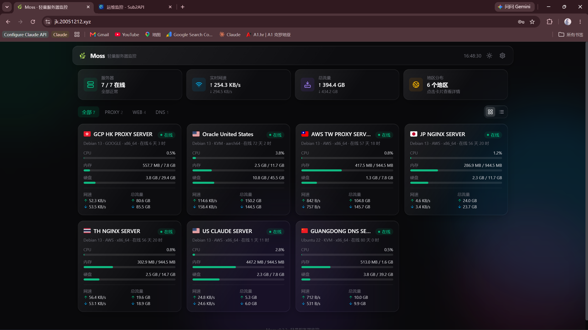

# Moss

> **看清每一台服务器。需要动手时,交给 AI。**

<p>
  <a href="https://github.com/J606y/moss/stargazers"></a>
  <a href="https://github.com/J606y/moss/releases"></a>
  <a href="./LICENSE"></a>
  <a href="https://ghcr.io/j606y/moss"></a>
</p>

**🔗 [在线演示 Live Demo](https://jk.20051212.xyz)** · **📖 [English](./README_EN.md)**



Moss 是一个装在你自己服务器上的监控面板。几台还是几十台机器,状态都在一个页面里;需要处理时,交给 AI 替你动手。

## 🚀 如何使用

在一台服务器上运行:

```bash
bash <(curl -fsSL https://raw.githubusercontent.com/J606y/moss/main/deploy/moss.sh)
```

装好后打开 `http://<服务器IP>:8787`,在后台「添加服务器」,把生成的命令复制到要监控的机器上运行。

想用 HTTPS?安装时选择「反代模式」,再用我们的 [nginx-rp](https://github.com/J606y/nginx-rp) 脚本,几分钟配好域名与证书。

## ✨ 特色

**简洁优美的界面**
CPU、内存、硬盘、网速,一屏看清。每两秒刷新,曲线平滑滚动,数字逐位跳动。

**异常及时推送**
离线、负载过高、网速异常、服务器到期,第一时间推送到 Telegram。恢复了,也会告诉你。

**GCP Spot 自动拉起**
Spot 实例被抢占关机后,Moss 自动把它开回来。不用半夜爬起来手动开机。

**AI 智控**
接入 AI 助手,让它查状态、跑命令、改配置。危险操作一律拦下,每一步都有记录。

**中英双语**
界面、报错、告警推送都有中文与英文。每位访客按自己的浏览器语言显示。

**一键更新**
面板和 agent,在后台点一下就能升级。新版本出了问题,自动退回原来的版本。

每个版本的变化见 [CHANGELOG](./CHANGELOG.md)。

欢迎 Issue / PR / Star ⭐ —— 觉得好用就点个星,这是对项目最大的鼓励。

## 📄 License

[MIT](./LICENSE) © j606y
