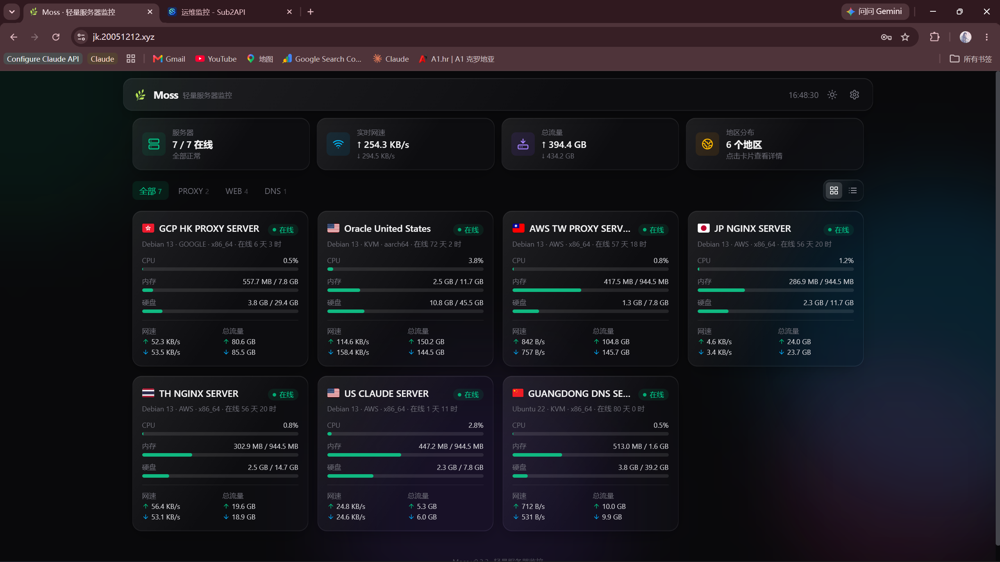

# Moss

> **See every server clearly. When it's time to act, hand it to AI.**

<p>
  <a href="https://github.com/J606y/moss/stargazers"></a>
  <a href="https://github.com/J606y/moss/releases"></a>
  <a href="./LICENSE"></a>
  <a href="https://ghcr.io/j606y/moss"></a>
</p>

**🔗 [Live Demo](https://jk.20051212.xyz)** · **📖 [中文 README](./README.md)**



Moss is a monitoring dashboard that runs on your own server. A few machines or a few dozen, all on one page. And when something needs fixing, AI can do it for you.

## 🚀 Get started

On any server, run:

```bash
bash <(curl -fsSL https://raw.githubusercontent.com/J606y/moss/main/deploy/moss.sh)
```

Then open `http://<server-ip>:8787`, click "Add server" in the admin panel, and run the command it gives you on each machine you want to monitor.

Want HTTPS? Choose "reverse proxy mode" during install, then set up your domain and certificate in minutes with our [nginx-rp](https://github.com/J606y/nginx-rp) script.

## ✨ Highlights

**A clean, beautiful interface**
CPU, memory, disk and network on one screen. Refreshed every two seconds, with smoothly scrolling charts and rolling digits.

**Alerts the moment it matters**
Offline, overloaded, unusual traffic, about to expire. Straight to Telegram. And when it recovers, you'll hear that too.

**GCP Spot, back on its own**
When a Spot instance is preempted, Moss starts it back up. No more getting up at 3 a.m. to do it yourself.

**AI in control**
Connect an AI assistant to check status, run commands and edit config. Dangerous operations are always blocked, and every step is on record.

**English and Chinese**
Interface, errors and alerts, in both languages. Every visitor sees their own browser's language.

**One-click updates**
Update the panel and every agent with a click. If a new version has problems, it rolls back on its own.

See the [CHANGELOG](./CHANGELOG.md) for what changed in each release.

Issues / PRs / Stars ⭐ welcome — if you find it useful, a star is the best encouragement.

## 📄 License

[MIT](./LICENSE) © j606y
